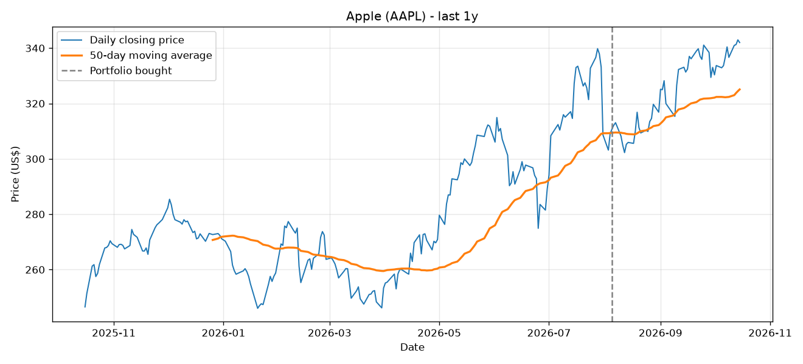

# Python Stock Price Charter

A short Python program that downloads daily prices for the 11 stocks in my mock portfolio (project 1) and the Nifty 50 index, calculates a **50-day moving average**, and plots both on one chart for each stock. A dashed line marks the day I bought the portfolio (5 August 2026).



## What is a 50-day moving average?

For each day, it is the average closing price of the previous 50 trading days. It smooths out the daily ups and downs so you can see the overall trend.

- **Price above its 50-day average:** the stock has recently been rising faster than its trend (often read as an uptrend).
- **Price below its 50-day average:** the stock has recently been weaker than its trend (often read as a downtrend).
- The orange line starts about 50 trading days after the blue one, because there isn't enough history before that to average.

## The portfolio

Apple (NASDAQ: AAPL), Eternal (Zomato), Reliance, Angel One, Infosys, LIC, Adani Ports, HDFC Bank, SBI, DOMS Industries and Indian Oil, with ₹9,000 put into each. The Nifty 50 is included to compare against the market.

## How to run it

**Option A: Google Colab (nothing to install)**
1. Go to [colab.research.google.com](https://colab.research.google.com) and create a new notebook.
2. Paste the whole of `stock_charter.py` into a cell and press **Shift + Enter**.
3. Open the folder icon on the left. The charts are in the `charts` folder; right-click a file to download it.

**Option B: on your own computer**
```
pip install -r requirements.txt
python stock_charter.py
```

## Changing the stocks

Edit the `STOCKS` list at the top of the script. Use the NSE symbol followed by `.NS` (for example `TATAMOTORS.NS`), `.BO` for BSE, or just the symbol for US stocks (for example `AAPL`). You can look up the exact symbol on [finance.yahoo.com](https://finance.yahoo.com). To change how much history is shown, set `PERIOD` to `"6mo"`, `"2y"` or `"5y"`.

## Interactive dashboard

`build_dashboard.py` goes one step further. It downloads the same prices, works out the portfolio's value in rupees every day since buying (Apple is converted using that day's USD/INR rate), and measures each stock:

- its return since buying
- how far it sits above or below its 50-day average
- whether that average is rising or falling
- when the price last crossed the average
- how many days since buying it closed above the average
- its typical daily move
- its biggest fall from a peak

It saves everything to `dashboard/data.js`.

```
python build_dashboard.py
```

Then open `dashboard/index.html` in a browser. The page has:

- **Portfolio against the market:** your ₹1,00,000 next to the same money in the Nifty 50, day by day. Hover over the chart, or use the arrow keys, to read any day.
- **Stock explorer:** pick any stock to see its price and 50-day average over 3 months, 6 months or 1 year, with a plain-English reading of the trend.
- **Winners and losers:** each stock's change since buying, with the Nifty 50 marked. Click a bar to open that stock.
- **Day-by-day trend strip:** one square per trading day, green when the price closed above its 50-day average.
- **A full table** of every number, and a short guide to reading the charts.

Run `build_dashboard.py` again any time to refresh the numbers.

## What each part of the code does

| Code | What it does |
|---|---|
| `import os` | Loads Python's built-in tool for working with folders, which the script uses to create the `charts` folder. |
| `import pandas as pd` | Loads pandas, the table library yfinance uses. The script uses it to turn the buy date into a date the chart understands. |
| `import yfinance as yf` | Loads the free yfinance library, which downloads price data from Yahoo Finance. `as yf` is a short nickname. |
| `import matplotlib.pyplot as plt` | Loads matplotlib, the standard Python library for drawing charts. |
| `STOCKS = { ... }` | A list of ticker symbols, each paired with a readable company name. `^NSEI` is the Nifty 50 index. |
| `PERIOD = "1y"` | How much price history to download (one year). |
| `MA_DAYS = 50` | The number of days in the moving average. |
| `BUY_DATE = "2026-08-05"` | The day the mock portfolio was bought. |
| `os.makedirs(OUTPUT_FOLDER, exist_ok=True)` | Creates the `charts` folder. `exist_ok=True` means "don't complain if it already exists". |
| `for ticker, name in STOCKS.items():` | Repeats everything indented below it once for each stock in the list. |
| `data = yf.download(...)` | Downloads one row per trading day (open, high, low, close, volume). `auto_adjust=True` corrects old prices for splits and bonus issues so the chart has no false jumps. |
| `if data.empty: ... continue` | If nothing came back (usually a typo in the ticker), prints a warning and moves on to the next stock. |
| `close = data["Close"].squeeze()` | Keeps only the closing-price column. `.squeeze()` turns it into a simple list of numbers. |
| `moving_avg = close.rolling(window=MA_DAYS).mean()` | The key line. `rolling(50)` looks at a sliding window of 50 days and `.mean()` averages it, for every day. |
| `plt.figure(figsize=(11, 5))` | Starts a new, empty chart 11 × 5 inches in size. |
| `plt.plot(close.index, close, ...)` | Draws the daily price as a thin blue line (dates on the x-axis, prices on the y-axis). |
| `plt.plot(moving_avg.index, moving_avg, ...)` | Draws the moving average as a thicker orange line on the same chart. |
| `plt.axvline(...)` | Draws a dashed grey vertical line on the buy date, so you can see how each stock moved after you bought it. |
| `plt.title / xlabel / ylabel` | Adds the chart title and axis labels. The y-axis says Rs for NSE/BSE stocks, US$ for Apple and "Index points" for the Nifty. |
| `plt.legend()` | Adds the small box that says which line is which. |
| `plt.grid(alpha=0.3)` | Adds faint grid lines to make values easier to read. |
| `plt.tight_layout()` | Adjusts the margins so no labels get cut off. |
| `filename = ...` | Builds a file name such as `RELIANCE_NS.png` (removes characters that are awkward in file names). |
| `plt.savefig(...)` | Saves the chart as a PNG picture in the `charts` folder. |
| `plt.close()` | Closes the chart to free memory before the next stock. |
| `last_price = close.iloc[-1]` | `iloc[-1]` means "the last row", which is the most recent closing price. |
| `trend = "ABOVE" if ... else "BELOW"` | Compares the latest price with its 50-day average. |
| `print(...)` | Prints a one-line summary for each stock. |

## Sample output (run on 16 October 2026)

```
Apple                        last close     342.00   50-day avg     325.07   price is ABOVE its average
Eternal (Zomato)             last close     325.40   50-day avg     323.88   price is ABOVE its average
Reliance Industries          last close    1210.50   50-day avg    1260.49   price is BELOW its average
Angel One                    last close     303.70   50-day avg     293.45   price is ABOVE its average
Infosys                      last close    1149.05   50-day avg    1087.02   price is ABOVE its average
LIC                          last close     396.40   50-day avg     404.25   price is BELOW its average
Adani Ports                  last close    1744.90   50-day avg    1726.67   price is ABOVE its average
HDFC Bank                    last close     729.35   50-day avg     718.52   price is ABOVE its average
State Bank of India          last close     959.40   50-day avg    1009.63   price is BELOW its average
DOMS Industries              last close    2101.60   50-day avg    2156.79   price is BELOW its average
Indian Oil Corporation       last close     129.18   50-day avg     135.14   price is BELOW its average
Nifty 50 index               last close   23120.10   50-day avg   23548.69   price is BELOW its average
```

Apple's price is in US dollars. The spreadsheet in project 1 converts it to rupees.

## What I learned

*(Write three or four lines here after you run it on your own portfolio. For example: which stocks stayed above their average, whether crossing the average was a useful signal, and what a moving average can't tell you.)*

## Tools used

Python, [yfinance](https://pypi.org/project/yfinance/), [matplotlib](https://matplotlib.org/), Google Colab.

*Price data comes from Yahoo Finance and is for learning only. It is not investment advice.*
